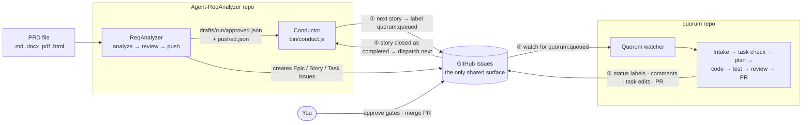
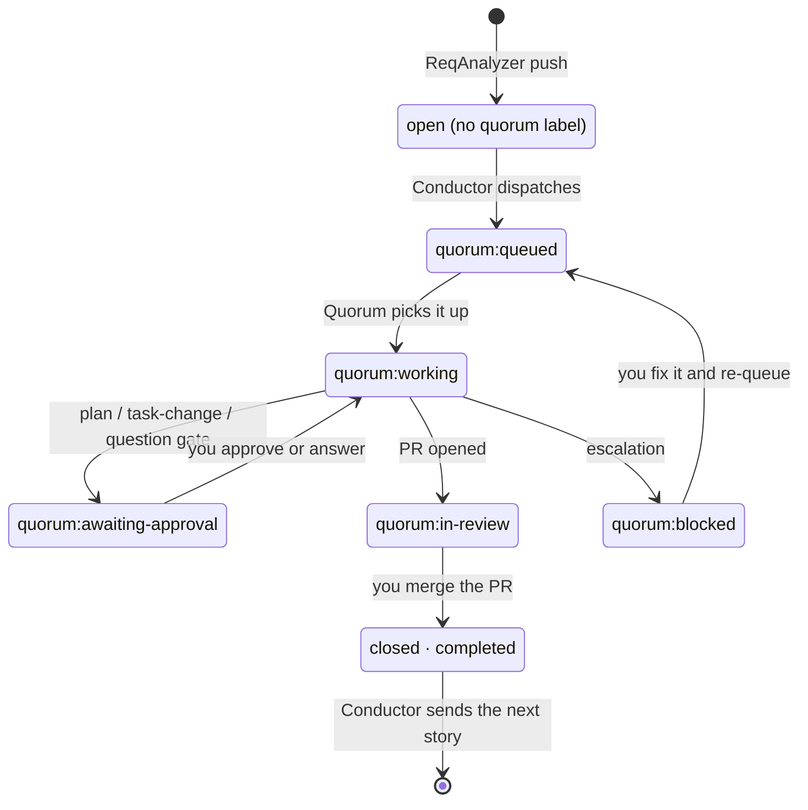

# Integration plan: ReqAnalyzer → Conductor → Quorum

**Status:** Implemented in this repo (live trial pending) · **Decided:** 2026-10-27 · **Owner:** Sangram Pattanayak
**This repo's part:** the **Conductor**, a new add-on in `Agent-ReqAnalyzer`.
**Companion document:** `quorum/INTEGRATION-PLAN.md`. Sections 1–3 are identical in both documents; keep them in sync.

---

## 1. Decision

ReqAnalyzer and Quorum stay **two independent agents**. They are **not merged** into one program.

- **ReqAnalyzer** turns a PRD into reviewed Epic → Story → Task issues on GitHub. Its existing code stays as it is.
- **Quorum** turns one GitHub issue into a tested, reviewed pull request.
- The **Conductor** is a new add-on in this repo and the only connection between the two. It takes the stories ReqAnalyzer created and hands them to Quorum **one at a time, in creation order**. It sends the next story only when the current one is **completed**, meaning its PR has been merged and the issue is closed.
- **GitHub issues are the only thing the agents share.** Neither agent calls the other or reads the other's files. They communicate only through labels, comments and issue state (section 3).
- Before planning, Quorum **checks the tasks** ReqAnalyzer created under each story. If they need changes, it proposes them, asks you to approve, and then updates the issues on GitHub.

**Why not merge them?**
- They run on different rhythms: once per PRD versus hours per story with human gates.
- Their setup differs: Quorum needs a local clone, git worktrees, the `gh` tool, Docker and LiteLLM; ReqAnalyzer needs only two keys.
- Their code differs: JavaScript, the Anthropic SDK and Octokit versus TypeScript, the Claude Agent SDK and `gh`.
- A failure in one can't break the other.
- ReqAnalyzer is useful on its own.

**Revisit the merge question if** two or more of these become true:
- the two are always used together, and one command matters more than running each separately
- one dashboard covering PRD → PR becomes a requirement
- Quorum's task check ends up redoing most of ReqAnalyzer's breakdown
- most features need changes in both repos at the same time

A middle step before a full merge is one repo with separate programs plus a small shared library.

## 2. How they connect



Life of one story:



## 3. The shared contract (GitHub)

### 3.1 Labels

| Label | Set by | Meaning |
|---|---|---|
| `quorum:queued` | Conductor (or a human) | Ready for Quorum to pick up |
| `quorum:working` | Quorum | A run is in progress |
| `quorum:awaiting-approval` | Quorum | Paused at a human gate: plan, task changes, or Intake questions |
| `quorum:in-review` | Quorum | PR opened; waiting for a human to review and merge |
| `quorum:blocked` | Quorum | Escalated. Quorum's comment says why. A human fixes the problem and adds `quorum:queued` back |
| `area:ui` | Conductor | The story has UI work, so Quorum requires Playwright E2E tests |

At most one `quorum:*` status label is on an issue at a time. Whoever sets a new one removes the old one.

### 3.2 What "completed" means
- **Completed:** the story issue is closed with reason *completed*. This happens when the PR containing `Closes #<story>` is merged.
- **Dropped:** the issue is closed as *not planned*, or the PR is closed without merging. The Conductor **pauses** and asks the human; it never skips silently.
- **A PR being opened is not completion.** The next story starts only after the merge, so it builds on the merged code.

### 3.3 Rules
1. **One story in progress per repo.** The Conductor never queues a story while any open issue in the repo carries `quorum:queued`, `quorum:working`, `quorum:awaiting-approval` or `quorum:in-review`. Quorum's watcher also runs one issue at a time.
2. **Only stories are dispatched.** Quorum handles a story's tasks inside that story's run.
3. **Keep the hidden markers.**
   - `<!-- reqagent:<run>:<draftId> -->` must stay in any issue Quorum edits. ReqAnalyzer relies on it to avoid creating duplicates if `push` is run again.
   - Task issues that Quorum creates carry `<!-- quorum:<runId>:<taskId> -->`.
4. **GitHub is the source of truth after handoff.** Once Quorum edits tasks, ReqAnalyzer's `approved.json` is history. Nothing reads it to find the current tasks.
5. **No shared files, no direct calls.** Either agent can be restarted, moved to another machine or replaced without the other noticing.

---

## 4. What we implement in this repo: the Conductor

### 4.1 Purpose
A small, separate command. It reads one ReqAnalyzer run folder, works out from GitHub where that run stands, and queues the next story for Quorum when the previous one is completed. When every story under an epic is completed, it closes the epic.

### 4.2 Constraints
- **No edits to existing ReqAnalyzer files** (`bin/reqagent.js`, `src/*.js`, `test/*`).
  - The Conductor may **import** existing helpers as they are: `runs.js` (`resolveRun`, `readJson`, `fingerprint`, `FILES`), `schema.js` (`orderItems`) and `history.js` (`logEvent`).
  - Anything else it needs, such as GitHub retry logic, is copied into its own files rather than changed in `github.js`.
- **No new dependencies.** Octokit, commander, picocolors and dotenv are already installed.
- **No memory of its own.** Each check rebuilds the full picture from the run folder plus GitHub. A crash, a reboot or running on another machine needs no recovery.
- **Same settings as `push`:** `GITHUB_TOKEN`, `GITHUB_REPO`, `GITHUB_API_URL` and `REQAGENT_DRAFTS_DIR`.

### 4.3 Inputs
| Input | Source |
|---|---|
| Run folder | `--run <name>` (default: latest run) |
| Story list and parent epics | `drafts/<run>/approved.json` (`type: "story"`) |
| Issue numbers and ids | `drafts/<run>/pushed.json` |
| Current state | GitHub: issue state, `state_reason` and labels |

### 4.4 Behaviour (one check)
1. **Load the stories.**
   - Join `approved.json` and `pushed.json`, keep the stories, and sort by issue number. That is creation order.
   - Check that `approved.json` still matches its fingerprint; refuse to continue if it was edited after approval.
   - Refuse to continue if any epic or story has no entry in `pushed.json` (the push did not finish).
2. **Filter.**
   - Leave out entries with `skipped: "duplicate"` (they point at issues that already existed) unless `--include-duplicates` is passed.
   - Stop if any story has a `linkError`, because Quorum couldn't find its tasks. Tell the user to run `reqagent push` again first, or pass `--ignore-link-errors`.
3. **Classify each story from GitHub:**
   - `pending`: open, no `quorum:*` label
   - `in-flight`: queued, working, awaiting-approval or in-review
   - `blocked`
   - `done`: closed as completed (a close with no reason, as on older GitHub Enterprise, counts as completed)
   - `dropped`: closed as not planned
4. **Decide.** Walk the stories in order and stop at the first one that isn't `done`:
   - `in-flight` → wait
   - `blocked` → wait, and log and print once
   - `dropped` → pause with exit code 2 and say how to continue: reopen the issue, or pass `--skip-dropped`
   - `pending` → **dispatch it**, but only if no other open issue in the repo is in progress (rule 3.3.1)
5. **Dispatch.**
   - Make sure the contract labels exist, creating them if needed.
   - Add `area:ui` if the story's labels include `frontend`, `ux` or `ui`.
   - Add `quorum:queued`.
   - Comment: *"Dispatched by reqagent conductor — run `<run>`, story i of n."*
6. **Roll up.** Close any open epic from this run whose dispatched stories are all completed, with a comment listing the merged PRs. Epics that already existed (duplicates) are never closed. Merged PRs are found from the story's GitHub timeline (best effort; the list may be empty).
7. **Finish.** When every story is completed, log it and exit 0.

### 4.5 Command line
```
node bin/conduct.js [--run <name>] [--repo owner/name]
                    [--interval 120] [--once] [--dry-run]
                    [--include-duplicates] [--ignore-link-errors] [--skip-dropped]
node bin/conduct.js status [--run <name>]     # table: story · issue · state · PR
```
- `--once` runs a single check and exits, so a scheduled task can run it.
- The default keeps checking at the set interval until the run is finished or paused.
- `--dry-run` shows what it would do without changing anything on GitHub (it still reads GitHub, and stops after the first would-be dispatch).

**Exit codes:**
- `0`: every story is completed
- `1`: error
- `2`: paused: a story was dropped, or (with `--once`) a story is blocked
- `3`: `--once` only: the run is still in progress (dispatched or waiting)

In the default loop a **blocked** story is not an exit: the Conductor keeps waiting (and prints it once) because a human re-queues the story. A **dropped** story always exits with `2`.

A `reqagent-conduct` entry in `package.json` `bin` is optional and is the only allowed change to an existing file.

### 4.6 History
Events are added to the existing `drafts/history.log` through `logEvent`, so `reqagent history` shows them:
- `conduct-dispatch`
- `conduct-wait`
- `conduct-paused`
- `conduct-epic-closed`
- `conduct-done`

### 4.7 New files
```
bin/conduct.js                    command line (commander); subcommands `run` (default) and `status`
src/conductor/stories.js          load + join + order + filter
src/conductor/github-state.js     Octokit client, retry, classify, ensure labels
src/conductor/dispatch.js         decide, dispatch, epic roll-up
test/mock-github-conductor.js     mock: issues get / labels / comments / close
test/conduct-offline.mjs          offline scenarios
```

---

## 5. TODO

### Phase 0: Contract
- [x] ~~Confirm label names, colours (queued `fbca04`, working `1d76db`, awaiting-approval `d93f0b`, in-review `5319e7`, blocked `b60205`, area:ui `bfd4f2`) and the definition of "completed" (section 3); mirror any change in `quorum/INTEGRATION-PLAN.md`~~

### Phase 1: Read the run (no GitHub writes)
- [x] ~~`stories.js`: load `approved.json` + `pushed.json` with `runs.js`; join; keep stories; sort by issue number~~
- [x] ~~Check the fingerprint of `approved.json`~~
- [x] ~~Handle `skipped: "duplicate"` (excluded by default) and `linkError` (stop by default)~~
- [x] ~~`conduct status` prints the story table, without the GitHub state yet~~

### Phase 2: GitHub state
- [x] ~~`github-state.js`: Octokit client from `GITHUB_TOKEN` / `GITHUB_REPO` / `GITHUB_API_URL`, plus a copied `withRetry`~~
- [x] ~~Classify each story: pending / in-flight / blocked / done / dropped, using `state` and `state_reason`~~
- [x] ~~Repo-wide check that no other issue is in progress~~
- [x] ~~Create the contract labels if missing~~
- [x] ~~`conduct status` now shows the GitHub state and the linked PR~~

### Phase 3: Dispatch loop
- [x] ~~The decide rules (4.4 step 4)~~
- [x] ~~Dispatch: `area:ui` mapping, `quorum:queued` label, comment~~
- [x] ~~Pause and exit codes for blocked and dropped stories; `--skip-dropped`~~
- [x] ~~Epic roll-up and close with a summary comment~~
- [x] ~~`--interval`, `--once`, `--dry-run`; Ctrl+C exits cleanly between checks~~
- [x] ~~`logEvent` for every decision~~

### Phase 4: Tests
- [x] ~~`mock-github-conductor.js`~~
- [x] ~~Scenarios in `conduct-offline.mjs`:~~
  - [x] ~~happy path with 3 stories in order~~
  - [x] ~~no dispatch while a story is in flight~~
  - [x] ~~blocked → re-queued → completed~~
  - [x] ~~dropped story pauses~~
  - [x] ~~restart mid-run resumes correctly~~
  - [x] ~~duplicate skipped~~
  - [x] ~~link error stops~~
  - [x] ~~epic closed after its last story~~
- [x] ~~Existing `npm test` still passes, untouched. The Conductor test runs separately: `node test/conduct-offline.mjs` (no change to the `test` script, to honour the no-edit rule)~~

### Phase 5: Live trial
- [ ] Sandbox repo + the PersonalTaskBoard run + Quorum `watch --mock`: full PRD → stories → merges
- [ ] One real story end to end with real models

## 6. Done when
- [x] ~~Given a pushed run, the Conductor queues exactly one story at a time, in creation order~~
- [x] ~~The next story is queued only after the previous story's issue is closed as completed~~
- [x] ~~Blocked and dropped stories pause the Conductor with a clear message; nothing is skipped silently~~
- [x] ~~Killing and restarting the Conductor at any point continues correctly, with no local state~~
- [x] ~~No existing ReqAnalyzer file is changed, except the optional `package.json` `bin` entry~~
- [x] ~~Every action shows up in `reqagent history`~~

## 7. Out of scope (for now)
- Running independent stories in parallel. ReqAnalyzer doesn't record dependencies, so stories stay serial.
- Webhooks or GitHub Actions triggers. Polling first.
- Jira or Azure DevOps.
- Changes to how ReqAnalyzer analyzes, reviews or pushes.
