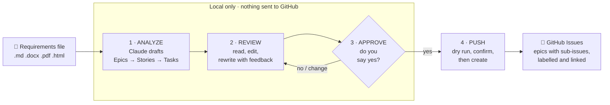

# Agent-ReqAnalyzer : requirements → GitHub issues, with your approval

Give it a requirements file (Markdown, Word, PDF or HTML). Claude breaks it into **Epics → Stories → Tasks** and you review them. **Nothing is created on GitHub until you approve.**



```
reqagent analyze requirements.docx   →  drafts + preview (no GitHub access)
reqagent review                      →  approve all / pick some / rewrite / cancel
reqagent push --repo owner/name      →  shows the plan, asks again, then creates
```

## How it works: analyze → review → approve → push

| Stage | Command | What happens | What it writes | Touches GitHub? |
|---|---|---|---|---|
| **1. Analyze** | `reqagent analyze <file>` | Reads your file, asks Claude to break it into Epics → Stories → Tasks, and checks the result against a strict schema (it asks Claude to fix any problems). Also lists vague or missing requirements to clarify. | `source.md`, `issues.json`, `preview.md`, `meta.json` in a new `drafts/<run>/` folder | No |
| **2. Review** | `reqagent review` (opens automatically after `analyze` in a terminal) | Shows a table of every draft and the "Requirements to clarify" list. You can read the full text of any issue, rewrite one with your feedback, or edit `issues.json` yourself and reload it. | New versions in `history/` for every rewrite or edit | No |
| **3. Approve** | the menu in `review`, or `reqagent review --approve all` / `--approve E1,E3.S2` | You choose **Approve all** or pick the issues you want (unticking an epic also drops its stories and tasks), then confirm. Only the approved items are saved, with a fingerprint so later edits are detected. | `approved.json` (plus a version in `history/`) | No |
| **4. Push** | `reqagent push --repo owner/name` | Checks the approval is intact, shows the plan (what will be created, new labels, duplicates to skip), and asks "Create N issue(s) on GitHub now?" Then it creates the labels and one issue per approved item, parents first, and links stories and tasks as sub-issues of their parent. | `pushed.json` (after every issue), `report.md` with links | **Yes, only after you confirm** |

Rules that keep it safe:

- **Nothing reaches GitHub before step 4.** `push` refuses to run without an approval, and refuses if `approved.json` was edited after you approved it.
- **Use `--dry-run` first.** `reqagent push --repo owner/name --dry-run` shows exactly what would happen and creates nothing.
- **Re-running is safe.** Each issue carries a hidden marker and duplicate titles are skipped, so an interrupted `push` picks up where it stopped without creating duplicates.
- **Everything is recorded.** `reqagent history` shows each analysis, rewrite, approval and push; `reqagent runs` shows which stage each run has reached (drafted, approved, pushed or failed).

## Setup (one time)

1. Install Node.js 20 or newer.
2. In this folder, run:
   ```
   npm install
   npm link        # optional: lets you type `reqagent` anywhere instead of `node bin/reqagent.js`
   ```
3. Copy `.env.example` to `.env` and fill in:
   - `ANTHROPIC_API_KEY`: from https://console.anthropic.com/settings/keys
   - `GITHUB_TOKEN`: a fine-grained token from https://github.com/settings/personal-access-tokens
     - Repository access: only the repo(s) you want issues in
     - Permissions: **Issues: Read and write** (Metadata: Read is added automatically)
   - optional: `GITHUB_REPO=owner/name` so you can leave out `--repo`; `CLAUDE_MODEL` to set your default model (see [Choosing the model](#choosing-the-model))
4. Check that everything works offline: `npm test`

Then follow the step-by-step guide below.

## Step-by-step: running it (Windows PowerShell)

The commands below use `node bin/reqagent.js`. If you ran `npm link`, you can type `reqagent` instead.

### Step 1: Open the project folder
```powershell
cd path\to\Agent-ReqAnalyzer
```

### Step 2: Install dependencies (first time, or after an update)
```powershell
npm install
```

### Step 3: Check the setup (optional, no API cost)
```powershell
npm test                      # should print: ✔ offline end-to-end test passed
node bin/reqagent.js models   # lists the Claude models your key can use, which confirms the API key works
```

### Step 4: Check your PRD reads correctly (optional)
```powershell
node bin/reqagent.js parse "D:\path\to\your-PRD.docx"
```
Skim the printed text. If it's empty or garbled (for example, a scanned PDF), fix the file before continuing.

### Step 5: Analyze the PRD
```powershell
node bin/reqagent.js analyze "D:\path\to\your-PRD.docx"
node bin/reqagent.js analyze "D:\path\to\your-PRD.docx" --model pick    # choose the model from a menu
```
Put the path in quotes if it contains spaces. When analysis finishes, it goes straight into review. Nothing has been sent to GitHub at this point.

### Step 6: Review and approve
You'll see:
- a table of every epic, story and task
- a list of requirements that need clarifying
- a menu (arrow keys to move, Enter to select)

Before approving, open `drafts\<latest-folder>\preview.md` in VS Code to read every issue in full. Then choose one of these:

| Choice | What it does |
|---|---|
| **Approve all** | approves every draft |
| **Choose which issues to create** | Space unticks an item, Enter confirms; unticking an epic also drops its stories and tasks |
| **Rewrite an issue with my feedback** | Claude rewrites that one issue; you keep it or discard it |
| **Cancel** | nothing is approved or created |

If you close it without approving, run `node bin/reqagent.js review` to come back.

### Step 7: Dry run against GitHub
```powershell
node bin/reqagent.js push --repo owner/repo --dry-run
```
Replace `owner/repo` with your repo, e.g. `my-org/my-app` (from `https://github.com/my-org/my-app`).

The dry run shows exactly what would be created, which labels are new, and which duplicates will be skipped. **Nothing is created.** If the token or repo is wrong, you'll find out here.

### Step 8: Create the issues
```powershell
node bin/reqagent.js push --repo owner/repo
```
It shows the plan again and asks **"Create N issue(s) on GitHub now?"**. Type `y` to go ahead.

### Step 9: Check the result
- `drafts\<latest-folder>\report.md` lists every issue with its link.
- On GitHub, open the repo's **Issues** tab. Epics show their stories as sub-issues, and stories show their tasks.

> **Tip:** add `GITHUB_REPO=owner/repo` to `.env` and you can leave out `--repo`. Try it on a test repo before your real one.

## Troubleshooting

| Message | What to do |
|---|---|
| `ANTHROPIC_API_KEY is not set` / `GITHUB_TOKEN is not set` | Check `.env` is in this folder and the line has no spaces around `=` |
| `Model "…" isn't available to your API key` | Run `node bin/reqagent.js models` and use one of the IDs listed |
| `Nothing has been approved for this run yet` | Run `node bin/reqagent.js review` and approve first |
| `approved.json was changed after approval` | Run `review` again to re-approve |
| `Repository owner/repo not found, or the token can't see it` | Check the repo name. Check the token has this repo under *Only select repositories* with **Issues: Read and write**. Organization repos may need an admin to approve the token. |
| `Issues are turned off` | Repo → Settings → General → Features → tick **Issues** |
| `The backlog was too large for one response` | Split the PRD by section and analyze each part |
| Push stopped halfway | Run the same `push` command again. It picks up where it stopped without creating duplicates. |
| `N issue(s) are not linked to their parent yet` | Run the same `push` command again. Failed sub-issue links are retried (shown as `RELINK` in the plan). |
| Analysis failed | The run is marked **failed** in `reqagent runs` and the error is saved in its `error.txt`. Run `analyze` again; `reqagent runs --clean` removes the failed folder. |
| Anything else | Run again with `$env:DEBUG=1` before the command to see the full error |

## Command reference

```bash
# 1. Draft. Goes straight into review when run in a terminal.
reqagent analyze docs/requirements.pdf
reqagent analyze spec.docx -i "Tasks should be backend-only; the mobile team plans its own"
reqagent analyze spec.docx --model opus        # pick the model for this run (see below)

# 2. Review (if you skipped it, or want to change your approval)
reqagent review
reqagent review --approve all            # without prompts
reqagent review --approve E1,E3.S2       # these items + everything under them

# 3. Create
reqagent push --repo my-org/my-app --dry-run   # see exactly what would happen
reqagent push --repo my-org/my-app             # shows the plan, asks "Create N issues now?"

# Other
reqagent parse file.pdf    # show the extracted text (check a PDF or DOCX reads correctly)
reqagent runs              # list past runs: drafted / approved / pushed / failed
reqagent runs --clean      # delete runs that never finished drafting (asks first)
reqagent history           # what happened, across all runs (add --run <name> for one run, -n 0 for everything)
reqagent models            # list the Claude models your key can use
```

## Choosing the model

By default the agent uses **Claude Haiku 4.5** (`claude-haiku-4-5-20251001`). You can change this for a single run or set a new default.

**For one run**, add `--model` (or `-m`) to `analyze`. You can give it:

| You type | What it uses |
|---|---|
| `--model claude-opus-5-5` | exactly that model ID |
| `--model "Claude Opus 5.5"` | the same model, using the name shown in `reqagent models` (quotes needed because of the spaces) |
| `--model opus` / `sonnet` / `haiku` / `fable` | the newest model in that family that your key can use |
| `--model pick` | a menu of the models available to you; use the arrow keys and press Enter |

```bash
reqagent analyze prd.docx --model opus
reqagent analyze prd.docx -m pick
```

**To change the default**, set `CLAUDE_MODEL` in `.env`. It takes the same values, so `CLAUDE_MODEL=pick` shows the menu every time. Whatever you pass to `--model` on the command line wins over `.env`.

**Which one should I use?**

| Model | Good for |
|---|---|
| Sonnet 5.5 | most PRDs; best balance of quality, speed and cost |
| Opus 5.5 | long or complex PRDs with many cross-cutting requirements |
| Fable 5.1 | the hardest documents where you want the deepest reasoning; slowest and costliest |
| Haiku 4.5 (default) | short, clear documents where you want a fast, cheap first pass |

Other things to know:

- `reqagent models` shows the exact model IDs your API key can use and which one is your current default.
- If you type a model your key can't use, it stops before calling the API and suggests close matches.
- The model used is saved with each run in `meta.json` and shown in `preview.md`.
- **Rewrite an issue** during review uses the same model that made the drafts. To use a different one, run `reqagent review --model <model>`.
- The agent adjusts automatically for models with a smaller output limit. You can also set `CLAUDE_MAX_TOKENS` in `.env` to cap it yourself.

### What the review step offers
- A table of every draft (ID, type, title, priority, size, labels) and a full `preview.md` you can open in VS Code.
- A **Requirements to clarify** list: vague ("should be fast"), untestable or missing requirements, each with a suggested question.
- Choices: approve all · untick the ones you don't want (unticking an epic also drops its stories and tasks) · show an issue's full text · rewrite one issue with your feedback · edit `issues.json` yourself and reload · cancel.

### What gets created on GitHub
- One issue per epic, story and task. The body has the description, acceptance criteria as checkboxes, priority, estimate, and a link back to the source requirement (e.g. `FR-3`).
- Labels: `type:epic|story|task`, `priority:high|medium|low`, `size:XS…XL`, plus domain labels (`backend`, `frontend`, …). Any that don't exist yet are created.
- Stories become **sub-issues** of their epic, and tasks of their story.
- **Safety**:
  - `push` won't run without an approval.
  - It refuses if `approved.json` was changed after you approved it.
  - It skips issues whose title already exists in the repo.
  - It keeps track of what it created, so running it again never makes duplicates and an interrupted push picks up where it stopped.

## Where files go

Each analysis gets a folder in `drafts/` (in the folder you run the command from):

| File | What it is |
|---|---|
| `meta.json` | source file, model used, time |
| `source.md` | text extracted from your file |
| `issues.json` | all drafts; you can edit this, then choose "reload" in review |
| `preview.md` | readable preview of every issue |
| `approved.json` | what you approved (push only creates these) |
| `pushed.json` | draft ID → GitHub issue number |
| `report.md` | final list with links |
| `history/` | every saved version: `issues.v001.json` (Claude's original), `issues.v002.json` (after a rewrite or your hand edit)…, and `approved.v001.json`, `approved.v002.json`… for each approval |
| `error.txt` | only for a failed analysis: the error and model used |

All runs also share one log, `drafts/history.log`. It records one line per event: analysis started, done or failed; rewrites (with your feedback); hand edits; approvals; pushes (created, re-linked, failed); and clean-ups. Read it with `reqagent history`.

## If something fails midway

| Where it fails | What's kept | What to do |
|---|---|---|
| `analyze` (network, API error, Ctrl+C) | The run folder with the extracted text and `error.txt`; shown as **failed** in `reqagent runs` | Run `analyze` again (it starts a fresh run). Remove the failed folder with `reqagent runs --clean`. |
| `review` | Every rewrite you accepted is already saved, as a new version | Run `reqagent review` again. Nothing is approved until you confirm. |
| `push` | `pushed.json` is saved after **every** issue, and each issue carries a hidden marker | Run the same `push` again. It creates only what's missing and never duplicates, even if it crashed right after GitHub created an issue. |
| Sub-issue link | The issue exists and mentions its parent; `report.md` says "created (link failed)" | Run the same `push` again. Failed links are retried automatically. |

```bash
reqagent runs                          # which runs finished, failed or are waiting for approval
reqagent history                       # timeline of the last 50 events across all runs
reqagent history --run <run-folder>    # one run's timeline + how many versions are saved
```

To go back to an earlier version of the drafts, copy for example `history/issues.v001.json` over `issues.json`, then run `reqagent review` (choose "reload" if review is already open). That restore is itself saved as a new version.

## Tips
- Very long documents: if Claude reports the backlog is too large, split the file by section and analyze each part.
- Scanned PDFs (images of text) need OCR first. Run `reqagent parse` to check.
- Requirement IDs like `FR-1` / `NFR-2` in your document make the links back to your requirements much more precise.
