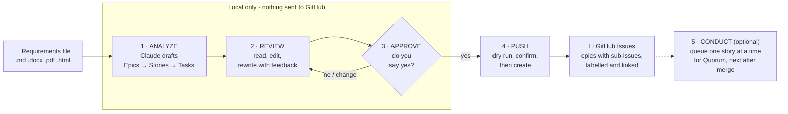
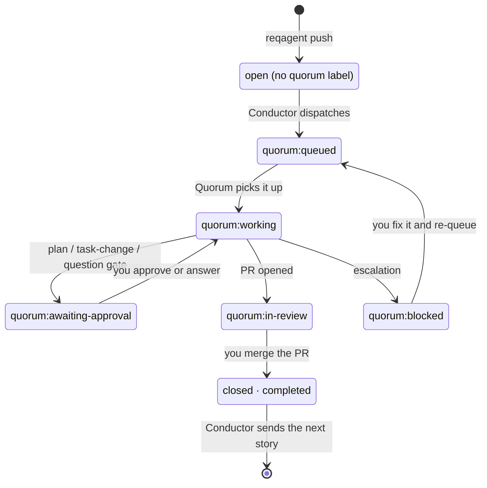

# Agent-ReqAnalyzer : requirements → GitHub issues, with your approval

Give it a requirements file (Markdown, Word, PDF or HTML). Claude breaks it into **Epics → Stories → Tasks** and you review them. **Nothing is created on GitHub until you approve.** An optional add-on, the **Conductor**, then hands the created stories to the Quorum coding agent one at a time (see [INTEGRATION-PLAN.md](INTEGRATION-PLAN.md)).



```
reqagent analyze requirements.docx   →  drafts + preview (no GitHub access)
reqagent review                      →  approve all / pick some / rewrite / cancel
reqagent push --repo owner/name      →  shows the plan, asks again, then creates
reqagent-conduct --once              →  (optional) queues the next story for Quorum
```

## How it works: analyze → review → approve → push (→ conduct)

| Stage | Command | What happens | What it writes | Touches GitHub? |
|---|---|---|---|---|
| **1. Analyze** | `reqagent analyze <file>` | Reads your file, asks Claude to break it into Epics → Stories → Tasks, and checks the result against a strict schema (it asks Claude to fix any problems). Also lists vague or missing requirements to clarify. | `source.md`, `issues.json`, `preview.md`, `meta.json` in a new `drafts/<run>/` folder | No |
| **2. Review** | `reqagent review` (opens automatically after `analyze` in a terminal) | Shows a table of every draft and the "Requirements to clarify" list. You can read the full text of any issue, rewrite one with your feedback, or edit `issues.json` yourself and reload it. | New versions in `history/` for every rewrite or edit | No |
| **3. Approve** | the menu in `review`, or `reqagent review --approve all` / `--approve E1,E3.S2` | You choose **Approve all** or pick the issues you want (unticking an epic also drops its stories and tasks), then confirm. Only the approved items are saved, with a fingerprint so later edits are detected. | `approved.json` (plus a version in `history/`) | No |
| **4. Push** | `reqagent push --repo owner/name` | Checks the approval is intact, shows the plan (what will be created, new labels, duplicates to skip), and asks "Create N issue(s) on GitHub now?" Then it creates the labels and one issue per approved item, parents first, and links stories and tasks as sub-issues of their parent. | `pushed.json` (after every issue), `report.md` with links | **Yes, only after you confirm** |
| **5. Conduct** *(optional)* | `reqagent-conduct` (or `node bin/conduct.js`) | Reads the run's stories and asks GitHub where each one stands. Adds the `quorum:queued` label to the **first story that isn't completed**, then waits until that story's issue is closed as *completed* (its PR merged) before queuing the next. Closes each epic when all its stories are done. See [The Conductor](#the-conductor-hand-stories-to-quorum-one-at-a-time). | Events in `drafts/history.log` only (it keeps no state of its own) | **Yes: labels, comments and epic closes on issues you already pushed** |

Rules that keep it safe:

- **Nothing reaches GitHub before step 4.** `push` refuses to run without an approval, and refuses if `approved.json` was edited after you approved it.
- **Use `--dry-run` first.** `reqagent push --repo owner/name --dry-run` shows exactly what would happen and creates nothing.
- **Re-running is safe.** Each issue carries a hidden marker and duplicate titles are skipped, so an interrupted `push` picks up where it stopped without creating duplicates.
- **Everything is recorded.** `reqagent history` shows each analysis, rewrite, approval, push and Conductor action; `reqagent runs` shows which stage each run has reached (drafted, approved, pushed or failed).

Want to see how it is built? Read the [code walkthrough](CODE_WALKTHROUGH.md): a tour of every module, the environment variables, and what changes if you swap the LLM provider.

## Setup (one time)

1. Install Node.js 20 or newer.
2. In this folder, run:
   ```
   npm install
   npm link        # optional: lets you type `reqagent` and `reqagent-conduct` anywhere instead of `node bin/reqagent.js` / `node bin/conduct.js`
   ```
3. Copy `.env.example` to `.env` and fill in:
   - `ANTHROPIC_API_KEY`: from https://console.anthropic.com/settings/keys
   - `GITHUB_TOKEN`: a fine-grained token from https://github.com/settings/personal-access-tokens
     - Repository access: only the repo(s) you want issues in
     - Permissions: **Issues: Read and write** (Metadata: Read is added automatically)
   - optional: `GITHUB_REPO=owner/name` so you can leave out `--repo`; `CLAUDE_MODEL` to set your default model (see [Choosing the model](#choosing-the-model))
4. Check that everything works offline:
   ```
   npm test                          # analyze → review → push
   node test/conduct-offline.mjs     # the Conductor (fake GitHub, no network)
   node test/web-offline.mjs         # the web UI server
   node test/web-browser.mjs         # the web page itself, in headless Chrome/Edge (optional)
   ```

Then follow the step-by-step guide below.

## Step-by-step: running it (Windows PowerShell)

The commands below use `node bin/reqagent.js`. If you ran `npm link`, you can type `reqagent` instead.

### Step 1: Open the project folder
```powershell
cd path\to\Agent-ReqAnalyzer
```

### Step 2: Install dependencies (first time, or after an update)
```powershell
npm install
```

### Step 3: Check the setup (optional, no API cost)
```powershell
npm test                      # should print: ✔ offline end-to-end test passed
node test/conduct-offline.mjs # should print: ✔ conductor offline test passed
node bin/reqagent.js models   # lists the Claude models your key can use, which confirms the API key works
```

### Step 4: Check your PRD reads correctly (optional)
```powershell
node bin/reqagent.js parse "D:\path\to\your-PRD.docx"
```
Skim the printed text. If it's empty or garbled (for example, a scanned PDF), fix the file before continuing.

### Step 5: Analyze the PRD
```powershell
node bin/reqagent.js analyze "D:\path\to\your-PRD.docx"
node bin/reqagent.js analyze "D:\path\to\your-PRD.docx" --model pick    # choose the model from a menu
```
Put the path in quotes if it contains spaces. When analysis finishes, it goes straight into review. Nothing has been sent to GitHub at this point.

### Step 6: Review and approve
You'll see:
- a table of every epic, story and task
- a list of requirements that need clarifying
- a menu (arrow keys to move, Enter to select)

Before approving, open `drafts\<latest-folder>\preview.md` in VS Code to read every issue in full. Then choose one of these:

| Choice | What it does |
|---|---|
| **Approve all** | approves every draft |
| **Choose which issues to create** | Space unticks an item, Enter confirms; unticking an epic also drops its stories and tasks |
| **Rewrite an issue with my feedback** | Claude rewrites that one issue; you keep it or discard it |
| **Cancel** | nothing is approved or created |

If you close it without approving, run `node bin/reqagent.js review` to come back.

### Step 7: Dry run against GitHub
```powershell
node bin/reqagent.js push --repo owner/repo --dry-run
```
Replace `owner/repo` with your repo, e.g. `my-org/my-app` (from `https://github.com/my-org/my-app`).

The dry run shows exactly what would be created, which labels are new, and which duplicates will be skipped. **Nothing is created.** If the token or repo is wrong, you'll find out here.

### Step 8: Create the issues
```powershell
node bin/reqagent.js push --repo owner/repo
```
It shows the plan again and asks **"Create N issue(s) on GitHub now?"**. Type `y` to go ahead.

### Step 9: Check the result
- `drafts\<latest-folder>\report.md` lists every issue with its link.
- On GitHub, open the repo's **Issues** tab. Epics show their stories as sub-issues, and stories show their tasks.

### Step 10: Hand the stories to Quorum (optional)
Only needed if you use the Quorum agent. Full details are in [The Conductor](#the-conductor-hand-stories-to-quorum-one-at-a-time).
```powershell
node bin/conduct.js status --repo owner/repo       # table of every story and where it stands
node bin/conduct.js --repo owner/repo --dry-run    # what would be queued first (changes nothing)
node bin/conduct.js --repo owner/repo              # queue story 1, then continue as each one is merged
```

> **Tip:** add `GITHUB_REPO=owner/repo` to `.env` and you can leave out `--repo`. Try it on a test repo before your real one.

## Web UI: upload a file instead of typing commands

A small local web page does the same steps for you. You upload a document; the page builds the `reqagent` commands and a local server runs them.

```bash
npm run web          # then open http://localhost:3000   (PORT=4000 npm run web to change the port)
```

| On the page | Command the server runs |
|---|---|
| **1. Upload & analyze** (PDF, .docx, .md, .html, up to 20 MB; optional model and instructions) | `reqagent analyze <file> --no-review [--model …] [--instructions …]` |
| **2. Review & approve** (tick the epics and stories you want; items are shown in creation order) | `reqagent review --run <run> --approve <ids>` |
| **2b. Change before approving**: **Edit** any item by hand, or **Regenerate** selected/all items with feedback for Claude | `reqagent-revise edit --run <run> --id <id> --file …` / `reqagent-revise regenerate --run <run> --ids <ids\|all> --feedback "…"` |
| **3. Create on GitHub** (**Preview** first, then **Create**, which asks you to confirm) | `reqagent push --run <run> --repo owner/name --dry-run`, then `… --yes` |
| **4. Conduct with Quorum** (story table, dispatch, auto-dispatch, history) | `reqagent-conduct --run <run> --repo owner/name --once` (or `--dry-run`, or the loop) |

- **Command panel** (right side, collapsible with the arrow): every command in order with its state, a progress bar while it runs (a "3 of 8 done" count for regenerate), cleaned-up output (no file paths or CLI hints), and clickable next steps such as *Review the drafts →* or *Conduct with Quorum →* on the latest finished command. It also shows the auto-dispatch loop if it is on.
- **Runs page:** the run list is a collapsible sidebar (it tucks away once a run is open) so the issue table uses the full width. Runs have readable names (from the file name; use **Rename** to change one). The stepper marks each step done (✓), current (●) or pending (○).
- **Requirements to clarify:** answer each question inline (Yes / No / Not needed, or type an answer). Answers are saved with the run, and **Regenerate affected items with my answers** rewrites the epics and stories that cite those requirements, passing your answers to Claude as feedback.
- **Issue table:** every row, tasks included, has a checkbox (ticking a story includes its tasks; untick single tasks to leave them out). Priority and size are dropdowns on each row; changes are staged and saved together (**Save changes**) as one new version. The **Bulk edit** bar sets priority or size for everything selected. A *modified* badge marks items changed since Claude's first draft, and a priority mix bar shows the spread.
- **Edit drawer:** **Edit** opens a side panel (your place in the list is kept) with Save / Cancel and an unsaved-changes notice. Its **History** tab compares any two saved versions of that item, field by field.
- **Sticky footer:** shows how many items are selected and **Approve selected (N) → Create on GitHub**, which opens a final confirm screen with the repository and the issue count. It then runs approve → preview (dry run) → create, and nothing is created until the last click.
- **Model picker:** the recommended models are pinned with what they are good for, their price per million tokens, and, once you choose a file, a rough cost and time range for it. Other models are in the *More models* menu. Costs and times are estimates from the file size and published list prices, not quotes.
- **History page:** wrapping rows with filters for run, event and text. Every table has loading and empty states. **Conductor:** dispatching and *Start auto-dispatch* both ask for confirmation (auto-dispatch also needs a tick-box acknowledgement).
- **Step 4** shows every story in dispatch order with its GitHub state, `quorum:*` labels and PR, and highlights the one that is next. *Dispatch next story to Quorum* runs one Conductor check; *Start auto-dispatch* runs the Conductor loop in the background (every 30 seconds) until you press *Stop*. The history table underneath comes from `drafts/history.log` (this run or all runs).
- **Changing drafts:** each item has an **Edit** button (title, description, acceptance criteria, labels, priority, estimate), and a *Regenerate* box rewrites the ticked items (or all) from your feedback, optionally with a different model. Every version is kept in the run's `history/` folder and logged. If you change drafts after approving, the page asks you to approve again and refuses to create issues until you do. Once issues exist on GitHub the drafts are frozen.
- Needs the same `.env` as the CLI (`ANTHROPIC_API_KEY`, `GITHUB_TOKEN`, optional `GITHUB_REPO`). The page warns if one is missing.
- **Safety:** the server listens on `127.0.0.1` only, rejects requests that don't come from its own page, runs commands with an argument list (never a shell), validates the repo, model and IDs, runs one command at a time, and only creates issues when the request carries an explicit confirmation after a successful preview. Don't expose the port to a network: whoever can reach it can use your tokens.
- Test it offline: `node test/web-offline.mjs` (server), and `node test/web-browser.mjs` (drives the real page in headless Chrome or Edge; skips itself if neither is installed, set `CHROME_PATH` to point at one, `SHOT_DIR=<folder>` saves screenshots).

## Run with Docker (or without it)

The same code runs either way: install Node and use the commands above, or use the Docker image, which has the web UI and all three CLI commands (`reqagent`, `reqagent-revise`, `reqagent-conduct`). Both use the same `drafts/` folder format, so you can start in one and carry on in the other.

One-time setup: copy `.env.example` to `.env` and fill it in (the file must exist; it is mounted into the container, never copied into the image). Put your requirement files in an `input/` folder.

```bash
# web UI: build, start in the background, open http://localhost:3000
docker compose up -d --build
docker compose logs -f web          # watch it;  docker compose down  to stop

# CLI: any command, files from ./input appear at /input, results land in ./drafts
docker compose run --rm cli reqagent analyze /input/my-prd.pdf --no-review
docker compose run --rm cli reqagent review --run <run>            # the interactive menu works (it needs a terminal)
docker compose run --rm cli reqagent-revise answers --run <run>
docker compose run --rm cli reqagent-conduct --run <run> --repo owner/name
docker compose run --rm cli npm test                               # the offline tests, inside the container
```

- **Different port:** `PORT=4000 docker compose up -d` (the page is then at http://localhost:4000).
- **Safety:** the port is published on your machine only (`127.0.0.1`), not your network; the server still rejects requests that don't come from its own page. Don't change that mapping to `0.0.0.0`: whoever can reach the page can use your tokens.
- **Changing the model:** edit `.env`. Because the file is mounted, the web UI picks up `CLAUDE_MODEL` changes without a restart, like outside Docker. Other values (API keys, repo) need `docker compose restart web`.
- **Files on Linux:** the container writes `drafts/` as user 1000. If your user has a different ID: `UID=$(id -u) GID=$(id -g) docker compose up -d`.
- **Plain `docker run`** also works: `docker build -t reqagent .` then `docker run --rm -it -v ./.env:/app/.env:ro -v ./drafts:/app/drafts reqagent reqagent runs` (add `-p 127.0.0.1:3000:3000` and drop the command to run the web UI).
- The browser test (`test/web-browser.mjs`) skips itself in the image because there is no browser in it.
- Docker Desktop (Windows/macOS) must be running before any `docker` command.

## Troubleshooting

| Message | What to do |
|---|---|
| `ANTHROPIC_API_KEY is not set` / `GITHUB_TOKEN is not set` | Check `.env` is in this folder and the line has no spaces around `=` |
| `Model "…" isn't available to your API key` | Run `node bin/reqagent.js models` and use one of the IDs listed |
| `Nothing has been approved for this run yet` | Run `node bin/reqagent.js review` and approve first |
| `approved.json was changed after approval` | Run `review` again to re-approve |
| `Repository owner/repo not found, or the token can't see it` | Check the repo name. Check the token has this repo under *Only select repositories* with **Issues: Read and write**. Organization repos may need an admin to approve the token. |
| `Issues are turned off` | Repo → Settings → General → Features → tick **Issues** |
| `The backlog was too large for one response` | Split the PRD by section and analyze each part |
| Push stopped halfway | Run the same `push` command again. It picks up where it stopped without creating duplicates. |
| `N issue(s) are not linked to their parent yet` | Run the same `push` command again. Failed sub-issue links are retried (shown as `RELINK` in the plan). |
| Analysis failed | The run is marked **failed** in `reqagent runs` and the error is saved in its `error.txt`. Run `analyze` again; `reqagent runs --clean` removes the failed folder. |
| `Not pushed yet: …` (conduct) | The push didn't finish. Run `reqagent push` again |
| `could not be linked to its parent` (conduct) | Run `reqagent push` again to retry the link, or pass `--ignore-link-errors` |
| Conductor exits with code 2 | A story is *dropped* (closed as not planned) or, with `--once`, *blocked*. See [Exit codes](#exit-codes) |
| Conductor keeps "waiting" | Another open issue in the repo has a `quorum:*` status label (one story at a time per repo). Finish or relabel it |
| Anything else | Run again with `$env:DEBUG=1` before the command to see the full error |

## Command reference

Every command is run as `reqagent <command>` (or `node bin/reqagent.js <command>`). Add `--help` to any command for its options. Commands that take a run use the **latest run** unless you pass `--run <folder-name>`.

| Command | Purpose | Touches GitHub? |
|---|---|---|
| [`parse`](#reqagent-parse) | Show the text extracted from a file | No |
| [`analyze`](#reqagent-analyze) | Draft Epics → Stories → Tasks with Claude | No |
| [`review`](#reqagent-review) | Read, edit, rewrite and approve drafts | No |
| [`push`](#reqagent-push) | Create the approved issues | Yes |
| [`runs`](#reqagent-runs) | List runs and their stage | No |
| [`history`](#reqagent-history) | Timeline of what happened | No |
| [`models`](#reqagent-models) | List usable Claude models | No (calls the Claude API) |
| [`conduct`](#conduct-run-default) | Queue stories for Quorum one at a time | Yes |
| [`conduct status`](#conduct-status) | Show each story's state | Reads only |

### `reqagent parse`
```bash
reqagent parse <file>
```
Prints the text extracted from a `.md`, `.docx`, `.pdf` or `.html` file, with its format and character count. No API calls. Use it to check a PDF or DOCX reads correctly.

### `reqagent analyze`
```bash
reqagent analyze <file> [-i <text>] [-m <model>] [--no-review]
```
| Option | Meaning |
|---|---|
| `-i, --instructions <text>` | Extra guidance for the breakdown, e.g. `"Tasks should be backend-only"` |
| `-m, --model <model>` | Full ID, name, shortcut (`opus` `sonnet` `haiku` `fable`) or `pick`. Default: `CLAUDE_MODEL`, else Haiku 4.5. See [Choosing the model](#choosing-the-model) |
| `--no-review` | Stop after drafting instead of going straight into review |

Creates a new `drafts/<run>/` folder. Failed analyses are kept and marked **failed**.
```bash
reqagent analyze docs/requirements.pdf
reqagent analyze spec.docx -i "Tasks should be backend-only; the mobile team plans its own"
reqagent analyze spec.docx --model opus
```

### `reqagent review`
```bash
reqagent review [-r <run>] [--approve <ids>] [-m <model>]
```
| Option | Meaning |
|---|---|
| `-r, --run <name>` | Which run (default: latest) |
| `--approve <ids>` | Approve without prompts: `all`, or IDs like `E1,E3.S2` (children are included) |
| `-m, --model <model>` | Model for "rewrite an issue" (default: the model that made the drafts) |

Without `--approve` it opens the interactive menu (see [What the review step offers](#what-the-review-step-offers)).

### `reqagent push`
```bash
reqagent push [--repo <owner/name>] [-r <run>] [--dry-run] [-y] [--delay <ms>]
```
| Option | Meaning |
|---|---|
| `--repo <owner/name>` | Target repository (default: `GITHUB_REPO`) |
| `-r, --run <name>` | Which run (default: latest) |
| `--dry-run` | Show what would be created; create nothing |
| `-y, --yes` | Skip the final "Create N issues now?" question |
| `--delay <ms>` | Pause between issues to respect GitHub limits (default `1000`) |

Safe to re-run: it only creates what is missing and retries failed sub-issue links.

### `reqagent runs`
```bash
reqagent runs [--clean] [-y]
```
Lists runs and their stage (drafted / approved / pushed / failed). `--clean` deletes runs that never finished drafting (asks first; `-y` skips the question).

### `reqagent history`
```bash
reqagent history [-r <run>] [-n <count>]
```
Shows `drafts/history.log`: analyses, rewrites, edits, approvals, pushes, clean-ups and `conduct-*` events. `-r` limits it to one run (and lists its saved versions); `-n` sets how many entries (default 50, `0` = all).

### `reqagent-revise`
Change drafts before you approve them (also available as buttons in the web UI). Every change is saved as a new version and logged; both commands refuse once the run has been pushed.
```bash
reqagent-revise regenerate --run <run> --ids <E1,E1.S2|all> --feedback "<what should change>" [-m <model>]
reqagent-revise edit --run <run> --id <E1.S2> --file changes.json    # any of: title, description, acceptance_criteria, labels, priority, estimate
reqagent-revise apply-edits --run <run> --file edits.json            # many items at once: {"E1.S1": {"priority": "low"}, "E1.S2": {"estimate": "M"}}
reqagent-revise answers --run <run>                                  # list the "requirements to clarify" questions and your answers
reqagent-revise answers --run <run> --set 0="Yes, mobile is in scope" --set 1="p95 under 300 ms"   # save answers (--clear 0 removes one)
reqagent-revise regenerate --run <run> --use-answers                 # rewrite the items that cite answered requirements, using your answers as feedback
reqagent-revise diff --run <run>                                     # which items changed since Claude's first draft (--from/--to pick versions)
reqagent-revise diff --run <run> --id E1.S2                          # field-by-field changes of one item (+ added, - removed)
reqagent-revise rename --run <run> --title "Payments PRD v2"         # a readable name, shown by `reqagent runs` and the web page
```
`answers`, `rename` and the web page share the same files (`answers.json`, `meta.json`), so an answer saved in one place shows up in the other. `--use-answers` accepts `--ids` to choose the items yourself and `--feedback` to add your own words; question numbers are the 0-based numbers `answers` prints. An item is "affected" when its source reference matches the answered requirement as a whole token (`FR-1` does not match `NFR-1`).
Approve again afterwards (`reqagent review --approve …`).

### `reqagent models`
```bash
reqagent models
```
Lists the Claude models your API key can use and marks the current default. Also a quick check that the key works.

### The Conductor commands
The Conductor is a separate program, `bin/conduct.js` (installed as `reqagent-conduct` by `npm link`). Both commands below accept the same **run options**:

| Run option | Meaning |
|---|---|
| `--run <name>` | Run folder under `drafts/` (default: latest) |
| `--repo <owner/name>` | Repository (default: `GITHUB_REPO`) |
| `--include-duplicates` | Also dispatch stories that `push` skipped as duplicates of existing issues (excluded by default) |
| `--ignore-link-errors` | Continue even if a story couldn't be linked to its parent epic (stops by default) |

#### `conduct` (run, default)
```bash
reqagent-conduct [run] [--interval <s>] [--once] [--dry-run] [--skip-dropped] [run options]
```
| Option | Meaning |
|---|---|
| `--interval <seconds>` | Time between checks (default `120`; decimals allowed) |
| `--once` | Run a single check and exit. Use this from a scheduled task |
| `--dry-run` | Show what would happen without changing GitHub. Still reads GitHub; stops after the first would-be dispatch |
| `--skip-dropped` | Move past stories that were closed as *not planned* instead of pausing |

#### `conduct status`
```bash
reqagent-conduct status [run options]
```
Prints a table: story · issue number · state · linked PR. Without a repo (`--repo` or `GITHUB_REPO`) it shows the run only, without GitHub state. Skipped duplicates appear at the bottom.

## The Conductor: hand stories to Quorum one at a time

The Conductor is optional. ReqAnalyzer and Quorum stay two independent programs that share **only GitHub issues**: the Conductor takes the stories `push` created and, one at a time and in creation order, adds the `quorum:queued` label that tells Quorum to start. The next story is queued only after the previous one is **completed**: its PR merged and its issue closed. The design is in [INTEGRATION-PLAN.md](INTEGRATION-PLAN.md).



### Step by step
1. **Finish the normal flow** through `reqagent push`, so the run has `approved.json` and `pushed.json`.
2. **Start Quorum's watcher** in the Quorum repo (see its README). It picks up issues labelled `quorum:queued`.
3. **Check the state** (read-only):
   ```bash
   reqagent-conduct status --repo owner/repo
   ```
4. **Rehearse** with a dry run:
   ```bash
   reqagent-conduct --repo owner/repo --dry-run
   ```
5. **Start the Conductor.** It queues story 1 and keeps checking:
   ```bash
   reqagent-conduct --repo owner/repo
   ```
6. **Work with Quorum on GitHub.** Approve its gates (plan, task changes, questions) and **merge each PR**. Merging closes the story as completed, and on its next check the Conductor queues the next story.
7. **Finish.** When every story is completed the Conductor closes the epics, prints `All N stories are completed` and exits 0.

Prefer a scheduled task over a long-running process? Run `reqagent-conduct --once` every few minutes instead.

### What one check does
1. Loads the stories from `approved.json` + `pushed.json`, sorted by issue number (creation order). It refuses if `approved.json` was edited after approval or if the push didn't finish.
2. Leaves out duplicates (unless `--include-duplicates`) and stops on link errors (unless `--ignore-link-errors`).
3. Reads each story's state from GitHub:

   | State | Meaning |
   |---|---|
   | `pending` | open, no `quorum:*` label |
   | `in-flight` | `quorum:queued`, `working`, `awaiting-approval` or `in-review` |
   | `blocked` | `quorum:blocked` |
   | `done` | closed as *completed* |
   | `dropped` | closed as *not planned* |
4. Walks the stories in order and acts on the **first one that isn't done**: `in-flight` → wait · `blocked` → wait (printed once) · `dropped` → pause · `pending` → dispatch.
5. **Dispatch** adds `quorum:queued` (plus `area:ui` if the story has a `frontend`, `ux` or `ui` label), creates any missing labels, and comments *"Dispatched by reqagent conductor — run `<run>`, story i of n."* It never dispatches while any other open issue in the repo carries a `quorum:*` status label.
6. **Roll-up** closes every open epic from this run whose stories are all completed, with a comment listing the merged PRs.

The Conductor keeps **no state of its own**: every check is rebuilt from the run folder plus GitHub, so you can stop it, restart it or move it to another machine at any time.

### Labels
| Label | Set by | Meaning |
|---|---|---|
| `quorum:queued` | Conductor (or you) | Ready for Quorum to pick up |
| `quorum:working` | Quorum | A run is in progress |
| `quorum:awaiting-approval` | Quorum | Paused at a human gate |
| `quorum:in-review` | Quorum | PR opened; waiting for you to review and merge |
| `quorum:blocked` | Quorum | Escalated; its comment says why. Fix it, then add `quorum:queued` back |
| `area:ui` | Conductor | The story has UI work, so Quorum requires Playwright tests |

### Exit codes
| Code | Meaning |
|---|---|
| `0` | Every story is completed |
| `1` | Error (bad run, missing token, edited approval, link error…) |
| `2` | Paused: a story was **dropped**, or (with `--once`) a story is **blocked**. In the default loop a blocked story is waited on, not an exit |
| `3` | `--once` only: still in progress (a story was dispatched or is being waited on) |

Press **Ctrl+C** to stop; the Conductor finishes its current check first. A dropped story pauses it: reopen the issue to continue with it, or run again with `--skip-dropped`.

### History
Every decision is added to `drafts/history.log`, so `reqagent history` shows it: `conduct-dispatch`, `conduct-wait`, `conduct-paused`, `conduct-epic-closed`, `conduct-done`.

## Choosing the model

By default the agent uses **Claude Haiku 4.5** (`claude-haiku-4-5-20251001`). You can change this for a single run or set a new default.

**For one run**, add `--model` (or `-m`) to `analyze`. You can give it:

| You type | What it uses |
|---|---|
| `--model claude-opus-5-5` | exactly that model ID |
| `--model "Claude Opus 5.5"` | the same model, using the name shown in `reqagent models` (quotes needed because of the spaces) |
| `--model opus` / `sonnet` / `haiku` / `fable` | the newest model in that family that your key can use |
| `--model pick` | a menu of the models available to you; use the arrow keys and press Enter |

```bash
reqagent analyze prd.docx --model opus
reqagent analyze prd.docx -m pick
```

**To change the default**, set `CLAUDE_MODEL` in `.env`. It takes the same values, so `CLAUDE_MODEL=pick` shows the menu every time. Whatever you pass to `--model` on the command line wins over `.env`.

**Which one should I use?**

| Model | Good for |
|---|---|
| Sonnet 5.5 | most PRDs; best balance of quality, speed and cost |
| Opus 5.5 | long or complex PRDs with many cross-cutting requirements |
| Fable 5.1 | the hardest documents where you want the deepest reasoning; slowest and costliest |
| Haiku 4.5 (default) | short, clear documents where you want a fast, cheap first pass |

Other things to know:

- `reqagent models` shows the exact model IDs your API key can use and which one is your current default.
- If you type a model your key can't use, it stops before calling the API and suggests close matches.
- The model used is saved with each run in `meta.json` and shown in `preview.md`.
- **Rewrite an issue** during review uses the same model that made the drafts. To use a different one, run `reqagent review --model <model>`.
- The agent adjusts automatically for models with a smaller output limit. You can also set `CLAUDE_MAX_TOKENS` in `.env` to cap it yourself.

### What the review step offers
- A table of every draft (ID, type, title, priority, size, labels) and a full `preview.md` you can open in VS Code.
- A **Requirements to clarify** list: vague ("should be fast"), untestable or missing requirements, each with a suggested question.
- Choices: approve all · untick the ones you don't want (unticking an epic also drops its stories and tasks) · show an issue's full text · rewrite one issue with your feedback · edit `issues.json` yourself and reload · cancel.

### What gets created on GitHub
- One issue per epic, story and task. The body has the description, acceptance criteria as checkboxes, priority, estimate, and a link back to the source requirement (e.g. `FR-3`).
- Labels: `type:epic|story|task`, `priority:high|medium|low`, `size:XS…XL`, plus domain labels (`backend`, `frontend`, …). Any that don't exist yet are created.
- Stories become **sub-issues** of their epic, and tasks of their story.
- **Safety**:
  - `push` won't run without an approval.
  - It refuses if `approved.json` was changed after you approved it.
  - It skips issues whose title already exists in the repo.
  - It keeps track of what it created, so running it again never makes duplicates and an interrupted push picks up where it stopped.

## Settings (`.env`)

| Variable | Used by | Meaning |
|---|---|---|
| `ANTHROPIC_API_KEY` | `analyze`, `review`, `models` | Claude API key |
| `GITHUB_TOKEN` | `push`, `conduct` | Fine-grained token with **Issues: Read and write** |
| `GITHUB_REPO` | `push`, `conduct` | Default `owner/name`, so you can leave out `--repo` |
| `GITHUB_API_URL` | `push`, `conduct` | API base URL, for GitHub Enterprise or a test server |
| `CLAUDE_MODEL` | `analyze`, `review` | Default model (ID, name, shortcut or `pick`) |
| `CLAUDE_MAX_TOKENS` | `analyze`, `review` | Cap on output tokens |
| `REQAGENT_DRAFTS_DIR` | all | Where run folders live (default `drafts/`) |

## Where files go

Each analysis gets a folder in `drafts/` (in the folder you run the command from):

| File | What it is |
|---|---|
| `meta.json` | source file, model used, time |
| `source.md` | text extracted from your file |
| `issues.json` | all drafts; you can edit this, then choose "reload" in review |
| `preview.md` | readable preview of every issue |
| `approved.json` | what you approved (push only creates these) |
| `pushed.json` | draft ID → GitHub issue number |
| `report.md` | final list with links |
| `history/` | every saved version: `issues.v001.json` (Claude's original), `issues.v002.json` (after a rewrite or your hand edit)…, and `approved.v001.json`, `approved.v002.json`… for each approval |
| `error.txt` | only for a failed analysis: the error and model used |

All runs also share one log, `drafts/history.log`. It records one line per event: analysis started, done or failed; rewrites (with your feedback); hand edits; approvals; pushes (created, re-linked, failed); Conductor dispatches, waits, pauses and epic closes; and clean-ups. Read it with `reqagent history`.

## If something fails midway

| Where it fails | What's kept | What to do |
|---|---|---|
| `analyze` (network, API error, Ctrl+C) | The run folder with the extracted text and `error.txt`; shown as **failed** in `reqagent runs` | Run `analyze` again (it starts a fresh run). Remove the failed folder with `reqagent runs --clean`. |
| `review` | Every rewrite you accepted is already saved, as a new version | Run `reqagent review` again. Nothing is approved until you confirm. |
| `push` | `pushed.json` is saved after **every** issue, and each issue carries a hidden marker | Run the same `push` again. It creates only what's missing and never duplicates, even if it crashed right after GitHub created an issue. |
| Sub-issue link | The issue exists and mentions its parent; `report.md` says "created (link failed)" | Run the same `push` again. Failed links are retried automatically. |

```bash
reqagent runs                          # which runs finished, failed or are waiting for approval
reqagent history                       # timeline of the last 50 events across all runs
reqagent history --run <run-folder>    # one run's timeline + how many versions are saved
```

To go back to an earlier version of the drafts, copy for example `history/issues.v001.json` over `issues.json`, then run `reqagent review` (choose "reload" if review is already open). That restore is itself saved as a new version.

## Tips
- Very long documents: if Claude reports the backlog is too large, split the file by section and analyze each part.
- Scanned PDFs (images of text) need OCR first. Run `reqagent parse` to check.
- Requirement IDs like `FR-1` / `NFR-2` in your document make the links back to your requirements much more precise.

## Contributing
Feedback, suggestions and contributions are welcome. Start with the [code walkthrough](CODE_WALKTHROUGH.md) to find your way around, and run `npm test` (offline, no API calls) before sending a change.
